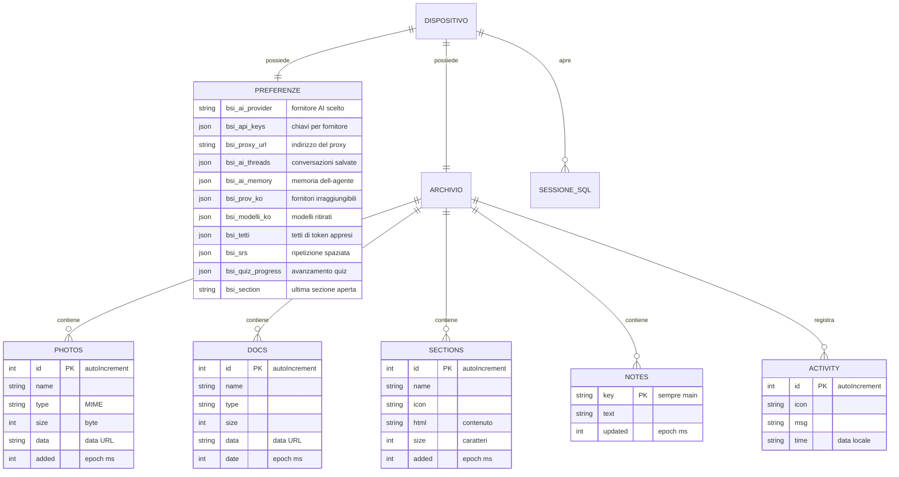

# Modello dei dati — BioSpecInfo

| Campo | Valore |
|-------|--------|
| **Software** | BioSpecInfo |
| **Versione descritta** | `bsi-v246` |
| **Scopo** | Documentare dove risiedono i dati, con quale struttura, e quale ciclo di vita hanno. |

---

## 0. Premessa necessaria

**BioSpecInfo non ha un database su server.** Non esiste un backend, quindi non
esistono tabelle relazionali gestite centralmente, migrazioni, o utenti
memorizzati da qualche parte.

Esiste però un modello dei dati reale, e un valutatore ha diritto di vederlo
documentato. Si articola su tre livelli:

| Livello | Tecnologia | Cosa contiene | Dove vive |
|---|---|---|---|
| **Preferenze e progressi** | `localStorage` | Impostazioni, chiavi API, cronologia AI, avanzamento nello studio | Browser dell'utente |
| **Archivio documenti** | IndexedDB | Foto, documenti, sezioni HTML, note, registro attività | Browser dell'utente |
| **Corpo di Spectra Studio** | IndexedDB (`bsi-spectra-modelli`) | Dalla v241 non si scrive più: il corpo è incorporato nell'app; il database si legge solo per cancellare un vecchio corpo | Browser dell'utente |
| **Dataset didattici** | SQLite via `sql.js` | Tabelle di esercitazione, create in memoria a ogni sessione | Memoria, non persistito |

**Tutti i dati restano sul dispositivo.** Non vengono trasmessi, non esiste un
identificativo utente lato server, e l'utente può cancellarli selettivamente
dall'interfaccia.

---

## 1. Diagramma delle entità

---

## 2. Preferenze e stato — `localStorage`

### 2.1 Assistente AI

| Chiave | Tipo | Contenuto | Ciclo di vita |
|---|---|---|---|
| `bsi_ai_provider` | stringa | Identificativo del fornitore selezionato | Finché l'utente non cambia |
| `bsi_api_keys` | JSON | `{ idFornitore: chiave }` | Fino a cancellazione esplicita |
| `bsi_api_key` | stringa | Chiave singola, formato storico | Migrata a `bsi_api_keys` |
| `bsi_proxy_url` | stringa | Indirizzo del proxy | Fino a «Scollega» |
| `bsi_ai_threads` | JSON | `{ threads: [...], activeId }` — max **30 chat**, **100 messaggi** ciascuna | Potatura automatica |
| `bsi_ai_memory` | JSON | Fatti che l'agente ricorda fra le sessioni | Cancellabile |
| `bsi_ai_history` | JSON | Cronologia sintetica | Cancellabile |
| `bsi_nucleo` | stringa | Modalità «nucleo» attiva | — |

### 2.2 Ciò che l'assistente impara sui fornitori

Queste tre chiavi sono il motivo per cui l'assistente migliora con l'uso invece
di ripetere gli stessi errori. Hanno una scadenza perché un guasto di oggi non
deve essere una condanna definitiva.

| Chiave | Struttura | Scadenza | A cosa serve |
|---|---|---|---|
| `bsi_prov_ko` | `{ idFornitore: { t: epoch, n: conteggio } }` | **24 ore** | Fornitori che da questo dispositivo non rispondono. Retrocessi nella scelta, mai rimossi. |
| `bsi_modelli_ko` | `{ impronta: { modelli: [...], t } }` | **7 giorni** | Modelli ritirati dal fornitore, per non riproporli. Indicizzati sull'impronta della chiave. |
| `bsi_tetti` | `{ idFornitore: tettoToken }` | Permanente | Tetto di token appreso dal messaggio d'errore, anziché codificato |

### 2.3 Studio e progressi

| Chiave | Contenuto |
|---|---|
| `bsi_srs` | Ripetizione spaziata: schede, intervalli, prossima revisione |
| `bsi_sm2` | Parametri dell'algoritmo SM-2 |
| `bsi_quiz_progress`, `bsi_quiz_history` | Avanzamento e storico dei quiz |
| `bsi_studypath` | Percorso di studio scelto |
| `bsi_notes`, `bsi_note_<sezione>` | Note personali, globali e per sezione |
| `bsi_ds_prog`, `bsi_ds_proj` | Avanzamento del modulo di data science |
| `bsi_section` | Ultima sezione aperta, per riprendere da lì |
| `bsi_guide_v3` | Guida introduttiva già vista |
| `bsi-materia` | Materia scelta: `chimica`, `fisica` o `matematica` |
| `bsi-studio:<materia>:studiati` | Kit di studio: riassunti segnati come studiati |
| `bsi-studio:<materia>:leitner` | Kit di studio: scatola di Leitner (1–5) di ogni flashcard, `{ id: scatola }` |
| `bsi-studio:<materia>:quiz` | Kit di studio: storico dei quiz ed errori da ripassare |

`<materia>` è `fisica`, `matematica` o `chimica`. Ogni lettura e scrittura del
kit è protetta: in navigazione privata il deposito può mancare o essere pieno,
e il kit resta usabile senza ricordare i progressi.

### 2.3-bis Spectra Live e la mente di Spectra

| Chiave | Contenuto | Ciclo di vita |
|---|---|---|
| `bsi-spectra-mente-v1` | JSON: `episodi` (al massimo 300: ora, materia, sezione, domanda troncata a 160 caratteri, esito), `sezioni` (tempo e visite per sezione), `ore` (24 contatori), `materie` (secondi per materia), `sessioni`, `ultimaVisita`, `stato` (`curiosita`, `attenzione`, `premura`, `umore`, `legame`, fra 0 e 1), `emozioni` (al massimo 60) | Finché l'utente non dice «dimentica tutto», che azzera l'oggetto e rimuove la chiave |
| `bsi-spectra-ritratto-v4` | Immagine PNG (data URL) del volto, ricavata una volta dal modello 3D e usata come icona di Spectra | Sostituisce `bsi-spectra-ritratto-v3`, che viene rimossa |
| `bsi-spectra-sentinella` | `'1'` mentre l'ascolto continuo della console è attivo | Rimossa quando l'ascolto si ferma |
| `bsi-spectra-creatore-v1` | JSON `{ ok: true, dal, ultima }` (millisecondi): il creatore è stato riconosciuto su questo dispositivo. **Non contiene la frase segreta né la sua impronta** | Scritta quando la prova riesce; rimossa con «dimentica che sono il tuo creatore» o con «Cancella dati → Memoria persistente» |
| `bsi-spectra-studio-v1` | JSON per lezione di Spectra Studio (`caduta`, `acqua`, `basilea`): `previsioni` (elenco di `{ quando, scelta, giusta }`) ed `esercizi` (indice dell'esercizio → ora in cui è stato aperto) | Scritta da `spectra-studio.html` a ogni previsione e a ogni esercizio aperto; rimossa con «Cancella dati → Memoria persistente» |
| `bsi-spectra-studio-voce` | `'0'` se la voce di Spectra Studio è stata spenta con 🔇; assente o diversa da `'0'` = accesa | Scritta dall'interruttore della voce dello studio; rimossa con «Cancella dati → Memoria persistente» |
| `bsi-esplora-v1` | JSON per capitolo di «⚡ Esplora con Spectra» (v242): `{ <id capitolo>: { giusta, quando } }` — l'esito dell'ultima previsione (giusta o sbagliata) e quando è stata fatta (millisecondi); da qui la barra «n/10» di ogni materia | Scritta da `bsi-spectra-esplora.js` a ogni previsione (rivedere un capitolo già previsto non la riscrive); rimossa con «Cancella dati → Memoria persistente» |

La mente è una simulazione di comportamento: la chiave contiene numeri e testi,
non altro. Il suo riassunto (`BSISpectraMente.coscienza()`) si aggiunge alle
domande che vanno al fornitore di intelligenza artificiale scelto
dall'utente; senza domande al modello non esce dal dispositivo.

La frase con cui il creatore si fa riconoscere (`bsi-spectra-creatore.js`) non
è un dato conservato: si scrive in un campo di tipo password, se ne calcola
l'impronta SHA-256, la si confronta con quella del File Manager e la si scarta.
Al modello va solo una riga di contesto: se l'utente è stato riconosciuto o no.

«🧠 Spiega» (`bsi-spectra-spiega.js`, v240) non conserva niente: la
conversazione resta in memoria per la sessione e «↺ Nuova spiegazione» la
azzera. Con «📺 Includi lo schermo» attivo, il testo dello schermo e
un'immagine dei grafici e delle scene 3D vanno al fornitore di IA
configurato insieme alla domanda (vedi
[`03-Security-Privacy-Compliance.md`](03-Security-Privacy-Compliance.md)).

La lezione guidata (`bsi-lezione.js`, v239) non ha chiavi sue: la lezione si
costruisce dalla pagina a ogni avvio e vive in memoria finché è aperta. I
comandi che mostra al lavoro tornano al valore che avevano. A fine lezione la
mente registra un'emozione («fiera») in `bsi-spectra-mente-v1`.

Spectra Studio (v239) ricava dalla sua chiave il livello di esercizio
consigliato (previsioni giuste più esercizi aperti, fino a 3) e manda ogni
previsione anche alla mente (`BSISpectraMente.ricorda`). Il corpo e le scene
dello studio non conservano niente.

«⚡ Esplora con Spectra» (`bsi-spectra-esplora.js`, v242) conserva solo le
previsioni, in `bsi-esplora-v1`; le posizioni dei cursori e il capitolo attivo
non si salvano. Non manda niente a nessuno: «🧠 Spiegamelo tutto» passa da
«🧠 Spiega», con le sue regole.

La voce di qualità (`bsi-spectra-voce.js`) legge la chiave OpenAI da
`bsi_api_keys` e non scrive niente: l'audio ricevuto resta in una cache in
memoria per la sessione. Il testo da pronunciare, invece, esce dal dispositivo
verso OpenAI quando la chiave c'è e la voce è accesa
([`03-Security-Privacy-Compliance.md`](03-Security-Privacy-Compliance.md) §1.2).
In Spectra Studio la scelta di spegnerla resta in `bsi-spectra-studio-voce`.

### 2.4 Identificativi e licenza

| Chiave | Contenuto | Nota sulla riservatezza |
|---|---|---|
| `bsi_device_id` | Identificativo casuale locale | **Non viene trasmesso.** Serve solo a distinguere le installazioni sullo stesso browser. |
| `bsi_user_email` | Email, se inserita dall'utente | Inserita volontariamente, non trasmessa |
| `bsi_pro_license`, `bsi_trial_start` | Stato della modalità Pro | Locale |
| `bsi_rdkit_lib2` | Libreria molecole del laboratorio | Locale |

---

## 3. Archivio documenti — IndexedDB

| | |
|---|---|
| **Nome database** | `bsi_filemanager_v1` |
| **Versione schema** | `2` |
| **Object store** | `photos`, `docs`, `sections`, `notes`, `activity` |

### 3.1 Struttura degli store

| Store | Chiave | Campi | Note |
|---|---|---|---|
| `photos` | `id` (autoIncrement) | `name`, `type`, `size`, `data`, `added` | Immagini come data URL. Limite per file: **20 MB** |
| `docs` | `id` (autoIncrement) | `name`, `type`, `size`, `data`, `date` | Documenti generici |
| `sections` | `id` (autoIncrement) | `name`, `icon`, `html`, `size`, `added` | Pagine HTML caricate dall'utente |
| `notes` | `key` | `key` (`"main"`), `text`, `updated` | Voce unica |
| `activity` | `id` (autoIncrement) | `icon`, `msg`, `time` | Registro delle ultime operazioni |

> Lo store `files`, presente in versioni precedenti dello schema, non è più
> creato dalla versione 2.

### 3.2 Apertura e indisponibilità

L'apertura di IndexedDB è **asincrona**, e in alcune configurazioni (Safari in
navigazione privata, dati dei siti bloccati) **non avviene mai**. Il codice
attende una promessa anziché leggere una variabile che potrebbe non essere
ancora valorizzata, e distingue due casi:

- **lettura** con archivio assente → restituisce un insieme vuoto, la pagina
  mostra «ancora niente»;
- **scrittura** con archivio assente → l'errore raggiunge chi ha premuto il
  pulsante, e in cima alla pagina compare un avviso persistente che nulla verrà
  conservato.

Se un'altra scheda richiede un aggiornamento di versione, la connessione viene
chiusa (`onversionchange`) per non bloccare entrambe.

### 3.3 Il corpo di Spectra Studio — `bsi-spectra-modelli`

| | |
|---|---|
| **Nome database** | `bsi-spectra-modelli` |
| **Object store** | `file` |
| **Chiave** | `corpo` |
| **Contenuto** | Fino alla v240: il file `.glb` (come `ArrayBuffer`) che l'utente aveva caricato con il pulsante «🧍 Corpo». **Dalla v241 non si scrive più niente** |
| **Chi lo scrive** | Nessuno, dalla v241 (il pulsante «🧍 Corpo» e il campo file sono stati tolti) |
| **Chi lo legge** | `Spectra.carica()` in `bsi-spectra-figura.js`, solo per **cancellare** un vecchio corpo, se c'è, e liberare spazio |
| **Cancellazione** | All'avvio, da `Spectra.carica()`; e «Cancella dati → Progressi del resto dell'app» (`DATI_CANCELLABILI.app` in `bsi-ai-hub.js`) elimina l'intero database |

Dalla v241 il corpo di Spectra è **incorporato nell'app** come blocco
impacchettato `models/spectra-corpo.bsi` (non un `.glb`: licenza Royalty Free
di CGTrader, il modello si usa dentro il prodotto e non si offre come file a
sé). Non è un dato dell'utente: si scarica dallo stesso sito dell'app e resta
nella cache del service worker, così dopo il primo avvio funziona senza
rete.

---

## 4. Dataset didattici — SQLite in memoria

Il modulo di esercitazione sui dati crea un database SQLite **in memoria**
tramite `sql.js` (SQLite compilato in WebAssembly). Le tabelle sono generate a
ogni sessione dai dataset inclusi nel repository e **non vengono persistite**:
chiudendo la scheda spariscono.

Questa scelta è deliberata: l'esercitazione deve partire da uno stato noto ogni
volta, e nessun dato dell'utente finisce in un database che non ha creato.

---

## 5. Dati di riferimento — costanti del codice

I dati scientifici non sono in un database ma in strutture costanti dentro
`index.html`, caricate con l'applicazione. Sono di sola lettura e versionate
insieme al codice.

| Struttura | Contenuto | Verifica |
|---|---|---|
| `FARM_DATA` | **263 farmaci**: nome, categoria, SMILES, peso molecolare, meccanismo d'azione, indicazioni, effetti avversi, classe; per 36 voci anche `chembl` e `formula` del record di provenienza | `audit_farmaci` — struttura ⟷ peso, duplicati, e formula ricostruita dal grafo contro quella di ChEMBL |
| `UV_DATA` | Cromofori, λmax, coefficienti di estinzione, regole di Woodward | `audit_dati` |
| `MS_DATA` | Frammentazioni caratteristiche per classe | `audit_dati` |
| `MOLECOLE_ESAME` | Molecole d'esame tabulate | `test_spettri` |
| `PHYS_SIMBOLI` | Costanti fisiche con simbolo e unità | `test_costanti` |
| `SMARTS`, `SMARTS_H` | Pattern per il riconoscimento dei gruppi funzionali | `test_spettri` |

---

## 6. Ciclo di vita e cancellazione

L'utente può cancellare i dati **per gruppi**, dall'interfaccia, senza azzerare
tutto. I gruppi sono definiti in `bsiCancellaDati()`.

| Gruppo | Cosa rimuove |
|---|---|
| `chat` | Conversazioni salvate e cronologia delle domande |
| `chiavi` | Chiavi API (anche nel formato vecchio), fornitore scelto, indirizzo del proxy, memoria sui fornitori e sui modelli irraggiungibili |
| `memoria` | Memoria persistente dell'assistente, la mente di Spectra (`bsi-spectra-mente-v1`) il riconoscimento del creatore (`bsi-spectra-creatore-v1`) e Spectra Studio (`bsi-spectra-studio-v1`, `bsi-spectra-studio-voce`) e le previsioni di «⚡ Esplora con Spectra» (`bsi-esplora-v1`) |
| `ripasso` | Ripetizione spaziata |
| `app` | Quiz, note, percorso di studio, progetti di data science, materia scelta (`bsi-materia`), progressi dei kit di studio (`bsi-studio:*`) e il database IndexedDB `bsi-spectra-modelli` (il corpo di Spectra Studio caricato dal dispositivo) |

Restano fuori dai gruppi `bsi-spectra-ritratto-v4` (l'icona ricavata dal
volto, che si rigenera) e `bsi-spectra-sentinella` (che si toglie da sola).

La cancellazione dell'archivio prosegue anche se una singola voce fallisce, e
riporta quante non sono state eliminate: un'operazione «elimina tutto» che si
ferma a metà senza dirlo sarebbe peggio del problema che risolve.

---

## 7. Conservazione e limiti di spazio

| Vincolo | Valore | Comportamento al superamento |
|---|---|---|
| `localStorage` | 5–10 MB secondo il browser | Le scritture falliscono. L'app resta operativa: le chat vengono potate (30 chat, 100 messaggi), e ogni scrittura è protetta. |
| IndexedDB | Quota concessa dal browser | Errore riportato a chi ha premuto, con avviso persistente |
| Singola immagine | 20 MB | Rifiutata con messaggio esplicito, il caricamento delle altre prosegue |

Il comportamento a spazio esaurito è verificato dai banchi `audit_quota` e
`test_filemanager`: dieci pagine su dieci restano utilizzabili con
`localStorage.setItem` forzato a fallire.

---

_Documento aggiornato alla versione `bsi-v246`._
