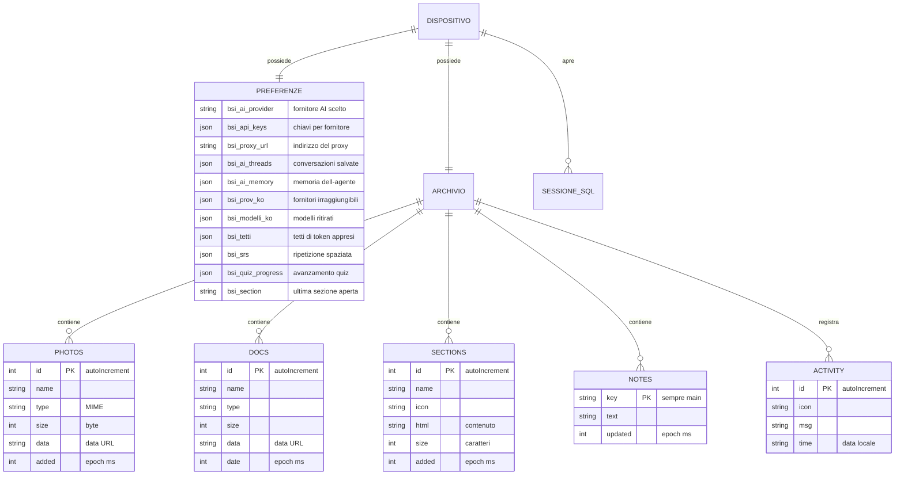

# Data Model — BioSpecInfo

| Field | Value |
|-------|--------|
| **Software** | BioSpecInfo |
| **Version described** | `bsi-v255` |
| **Purpose** | Document where the data live, with what structure, and what lifecycle they have. |

---

## 0. A necessary premise

**BioSpecInfo has no server database.** There is no backend, so there are no
centrally managed relational tables, no migrations, and no users stored
anywhere.

There is, however, a real data model, and an assessor is entitled to see it
documented. It is organised across three levels:

| Level | Technology | What it holds | Where it lives |
|---|---|---|---|
| **Preferences and progress** | `localStorage` | Settings, API keys, AI history, study progress | The user's browser |
| **Document archive** | IndexedDB | Photos, documents, HTML sections, notes, activity log | The user's browser |
| **Spectra Studio body** | IndexedDB (`bsi-spectra-modelli`) | No longer written since v241: the body is embedded in the app; the database is read only to delete an old body | The user's browser |
| **Spectra's memory** | IndexedDB (`bsi-spectra-memoria`, store `ricordi`) | Five-level memories (v254): `id`, `tipo` (episode, fact, procedure, autobiography, reflection), `testo` up to 600 characters, `chiave` against duplicates, `creato`, `ultimo_accesso`, `accessi`, `importanza`, `fiducia`, `stabilita` in days (forgetting R = e^(−Δt/S)), `fonte`, `sezione`, `concetti`, `legami`, `vettore` (256 components, local embedding), `dispositivo`, `orologio`, `fissato`, `archiviato` | The user's browser; leaves only with «export the memory» |
| **Teaching datasets** | SQLite via `sql.js` | Exercise tables, created in memory at each session | Memory, not persisted |

**All data stay on the device.** They are not transmitted, there is no
server-side user identifier, and the user can delete them selectively from the
interface.

---

## 1. Entity diagram

> The diagram keeps the entity and field names as they appear in the code, in
> Italian: renaming them in the translation would document a model that does not
> exist.

---

## 2. Preferences and state — `localStorage`

### 2.1 AI assistant

| Key | Type | Content | Lifecycle |
|---|---|---|---|
| `bsi_ai_provider` | string | Identifier of the selected provider | Until the user changes it |
| `bsi_api_keys` | JSON | `{ providerId: key }` | Until explicitly deleted |
| `bsi_api_key` | string | Single key, legacy format | Migrated to `bsi_api_keys` |
| `bsi_proxy_url` | string | Proxy address | Until "Disconnect" |
| `bsi_ai_threads` | JSON | `{ threads: [...], activeId }` — max **30 chats**, **100 messages** each | Pruned automatically |
| `bsi_ai_memory` | JSON | Facts the agent remembers between sessions | Deletable |
| `bsi_ai_history` | JSON | Condensed history | Deletable |
| `bsi_nucleo` | string | "Core" mode active | — |

### 2.2 What the assistant learns about providers

These three keys are the reason the assistant improves with use instead of
repeating the same mistakes. They have an expiry because today's failure must
not be a permanent sentence.

| Key | Structure | Expiry | What it is for |
|---|---|---|---|
| `bsi_prov_ko` | `{ providerId: { t: epoch, n: count } }` | **24 hours** | Providers that do not answer from this device. Demoted in the selection, never removed. |
| `bsi_modelli_ko` | `{ digest: { modelli: [...], t } }` | **7 days** | Models retired by the provider, so as not to offer them again. Indexed on the digest of the key. |
| `bsi_tetti` | `{ providerId: tokenCeiling }` | Permanent | Token ceiling learned from the error message rather than hard-coded |

### 2.3 Study and progress

| Key | Content |
|---|---|
| `bsi_srs` | Spaced repetition: cards, intervals, next review |
| `bsi_sm2` | Parameters of the SM-2 algorithm |
| `bsi_quiz_progress`, `bsi_quiz_history` | Quiz progress and history |
| `bsi_studypath` | The study path chosen |
| `bsi_notes`, `bsi_note_<section>` | Personal notes, global and per section |
| `bsi_ds_prog`, `bsi_ds_proj` | Progress in the data-science module |
| `bsi_section` | Last section opened, to resume from there |
| `bsi_guide_v3` | Introductory guide already seen |
| `bsi-materia` | Chosen subject: `chimica`, `fisica` or `matematica` |
| `bsi-studio:<subject>:studiati` | Study kit: summaries marked as studied |
| `bsi-studio:<subject>:leitner` | Study kit: Leitner box (1–5) of each flashcard, `{ id: box }` |
| `bsi-studio:<subject>:quiz` | Study kit: quiz history and mistakes to review |

`<subject>` is `fisica`, `matematica` or `chimica`. Every read and write of the
kit is guarded: in private browsing the storage may be missing or full, and
the kit stays usable without remembering progress.

### 2.3-bis Spectra Live and Spectra's mind

| Key | Content | Lifecycle |
|---|---|---|
| `bsi-spectra-mente-v1` | JSON: `episodi` (at most 300: time, subject, section, question cut to 160 characters, outcome), `sezioni` (time and visits per section), `ore` (24 counters), `materie` (seconds per subject), `sessioni`, `ultimaVisita`, `stato` (`curiosita`, `attenzione`, `premura`, `umore`, `legame`, between 0 and 1), `emozioni` (at most 60) | Until the user says «forget everything», which resets the object and removes the key |
| `bsi-spectra-agenda-v1` | JSON: `voci` (reminders, tasks, events: `id`, `genere`, `testo` up to 240 characters, `quando` in milliseconds or null, `anticipo`, `ripeti`, `stato`, `creato`, `chiuso`; at most 60 closed entries), `n` (counter) | Written by `bsi-spectra-agenda.js`; stays in the browser; deleted with the «memoria» group and exported with «esporta la memoria» |
| `bsi-spectra-memoria-stato` | JSON: `dispositivo` (random device identifier), `ultimaCura` (time of the last consolidation), `ultimoEpisodio` (the last mind episode already imported), `capitoli` (the months already written) | Written by `bsi-spectra-memoria.js` (v254); consolidation runs at the first opening of the day |
| `bsi-spectra-memoria-riserva` | JSON: copy of the memories when IndexedDB is unavailable | Used only as a fallback; deleted with the app data |
| `bsi-mat-mappa-noti` | JSON: the mathematics topics ticked «I already know it» in the prerequisite map | Written by `bsi-mat-mappa.js` (v255); «Reset what I already know» empties it |
| `bsi-spectra-sentinella` | `"1"` when «always listening» is on | Written by `bsi-spectra-live.js` (v255); on reopening the sentinel restarts by itself if microphone permission exists, otherwise on first touch; turning it off deletes it |
| `bsi-spectra-novita-v252` | `"1"` once the «Novità di Spectra» panel has been shown | Written by `bsi-spectra-risveglio.js`; used to show it once only |
| `bsi-spectra-risveglio-v1` | JSON: `citta`, `lat`, `lon` (the city chosen with «abito a…»), `armato` (true after the first wake-up), `briefing` (the 8:00 and 20:00 briefing on or off), `fatti` (the last ten slots already done), `meteo` (the last weather, kept 15 minutes), `ascolto` (glasses mode on: restarts on opening), `avvioSveglia` (Spectra wakes up at every opening) | Written by `bsi-spectra-risveglio.js`; stays in the browser; deleted with the «memoria» group and exported with «esporta la memoria» |
| `bsi-spectra-ritratto-v4` | PNG image (data URL) of the face, derived once from the 3D model and used as Spectra's icon | Replaces `bsi-spectra-ritratto-v3`, which is removed |
| `bsi-spectra-sentinella` | `'1'` while the console's continuous listening is on | Removed when listening stops |
| `bsi-spectra-creatore-v1` | JSON `{ ok: true, dal, ultima }` (milliseconds): the creator has been recognised on this device. **It contains neither the secret phrase nor its fingerprint** | Written when the proof succeeds; removed by «forget that I am your creator» or by «Clear data → Persistent memory» |
| `bsi-spectra-studio-v1` | JSON per Spectra Studio lesson (`caduta`, `acqua`, `basilea`): `previsioni` (list of `{ quando, scelta, giusta }`) and `esercizi` (exercise index → time it was opened) | Written by `spectra-studio.html` at every prediction and every exercise opened; removed by «Clear data → Persistent memory» |
| `bsi-spectra-studio-voce` | `'0'` if Spectra Studio's voice has been turned off with 🔇; absent or other than `'0'` = on | Written by the studio's voice switch; removed by «Clear data → Persistent memory» |
| `bsi-esplora-v1` | JSON per «⚡ Explore with Spectra» chapter (v242): `{ <chapter id>: { giusta, quando } }` — the outcome of the last prediction (right or wrong) and when it was made (milliseconds); the «n/10» bar of each subject comes from here | Written by `bsi-spectra-esplora.js` at every prediction (reviewing a chapter already predicted does not rewrite it); removed by «Clear data → Persistent memory» |

The mind is a simulation of behaviour: the key holds numbers and text,
nothing else. Its summary (`BSISpectraMente.coscienza()`) is added to the
questions that go to the artificial-intelligence provider the user chose;
without questions to the model it does not leave the device.

The phrase with which the creator makes himself known (`bsi-spectra-creatore.js`)
is not stored data: it is typed into a password field, its SHA-256 fingerprint
is computed, compared with the File Manager's and discarded. The model receives
only one line of context: whether the user has been recognised or not.

«🧠 Spiega» (`bsi-spectra-spiega.js`, v240) stores nothing: the conversation
is kept in memory for the session and «↺ Nuova spiegazione» clears it. With
«📺 Includi lo schermo» checked, the screen text and an image of the graphs and
3D scenes go to the configured AI provider together with the question (see
[`03-Security-Privacy-Compliance.md`](03-Security-Privacy-Compliance.md)).

The guided lesson (`bsi-lezione.js`, v239) has no keys of its own: the lesson
is built from the page at every start and lives in memory while it is open.
The controls it shows at work return to the value they had. At the end of a
lesson the mind records an emotion («fiera», proud) in `bsi-spectra-mente-v1`.

Spectra Studio (v239) derives from its key the recommended exercise level
(right predictions plus exercises opened, up to 3) and also sends each
prediction to the mind (`BSISpectraMente.ricorda`). The studio's body and scenes
store nothing.

«⚡ Explore with Spectra» (`bsi-spectra-esplora.js`, v242) keeps only the
predictions, in `bsi-esplora-v1`; slider positions and the active chapter are
not saved. It sends nothing to anyone: «🧠 Spiegamelo tutto» goes through
«🧠 Spiega», with its rules.

The quality voice (`bsi-spectra-voce.js`) reads the OpenAI key from
`bsi_api_keys` and writes nothing: the audio received stays in an in-memory
cache for the session. The text to be spoken, however, leaves the device for
OpenAI when the key is there and the voice is on
([`03-Security-Privacy-Compliance.md`](03-Security-Privacy-Compliance.md) §1.2).
In Spectra Studio the choice to turn it off is kept in `bsi-spectra-studio-voce`.

### 2.4 Identifiers and licence

| Key | Content | Privacy note |
|---|---|---|
| `bsi_device_id` | Random local identifier | **Not transmitted.** It only distinguishes installations within the same browser. |
| `bsi_user_email` | Email, if entered by the user | Entered voluntarily, not transmitted |
| `bsi_pro_license`, `bsi_trial_start` | State of Pro mode | Local |
| `bsi_rdkit_lib2` | Molecule library of the laboratory | Local |

> That none of these ever leaves the device is verified directly by
> `audit_rete`, which seeds a canary value into these very keys and then
> inspects every outgoing request.

---

## 3. Document archive — IndexedDB

| | |
|---|---|
| **Database name** | `bsi_filemanager_v1` |
| **Schema version** | `2` |
| **Object stores** | `photos`, `docs`, `sections`, `notes`, `activity` |

### 3.1 Structure of the stores

| Store | Key | Fields | Notes |
|---|---|---|---|
| `photos` | `id` (autoIncrement) | `name`, `type`, `size`, `data`, `added` | Images as data URLs. Per-file limit: **20 MB** |
| `docs` | `id` (autoIncrement) | `name`, `type`, `size`, `data`, `date` | Generic documents |
| `sections` | `id` (autoIncrement) | `name`, `icon`, `html`, `size`, `added` | HTML pages uploaded by the user |
| `notes` | `key` | `key` (`"main"`), `text`, `updated` | A single entry |
| `activity` | `id` (autoIncrement) | `icon`, `msg`, `time` | Log of the most recent operations |

> The `files` store, present in earlier schema versions, is no longer created
> from version 2.

### 3.2 Opening and unavailability

Opening IndexedDB is **asynchronous**, and in some configurations (Safari in
private browsing, site data blocked) it **never happens**. The code awaits a
promise rather than reading a variable that might not yet be set, and
distinguishes two cases:

- **reading** with the store absent → returns an empty set, the page shows
  "nothing yet";
- **writing** with the store absent → the error reaches whoever pressed the
  button, and a persistent warning appears at the top of the page saying nothing
  will be kept.

If another tab requests a version upgrade, the connection is closed
(`onversionchange`) so as not to block both.

### 3.3 The Spectra Studio body — `bsi-spectra-modelli`

| | |
|---|---|
| **Database name** | `bsi-spectra-modelli` |
| **Object store** | `file` |
| **Key** | `corpo` |
| **Content** | Up to v240: the `.glb` file (as an `ArrayBuffer`) the user had loaded with the «🧍 Corpo» button. **Since v241 nothing is written any more** |
| **Who writes it** | Nobody, since v241 (the «🧍 Corpo» button and the file input were removed) |
| **Who reads it** | `Spectra.carica()` in `bsi-spectra-figura.js`, only to **delete** an old body, if any, and free the space |
| **Erasure** | On start, by `Spectra.carica()`; and «Clear data → Progress in the rest of the app» (`DATI_CANCELLABILI.app` in `bsi-ai-hub.js`) deletes the whole database |

Since v241 Spectra's body is **embedded in the app** as the packed block
`models/spectra-corpo.bsi` (not a `.glb`: CGTrader's Royalty Free licence lets
the model be used inside the product, not offered as a standalone file). It is
not user data: it is downloaded from the app's own site and kept in the
service worker's cache, so after the first start it works without a network.

---

## 4. Teaching datasets — SQLite in memory

The data-exercise module creates an SQLite database **in memory** through
`sql.js` (SQLite compiled to WebAssembly). The tables are generated at each
session from the datasets bundled in the repository and are **not persisted**:
closing the tab makes them vanish.

The choice is deliberate: the exercise must start from a known state every time,
and no user data end up in a database they did not create.

---

## 5. Reference data — constants in the code

The scientific data are not in a database but in constant structures inside
`index.html`, loaded with the application. They are read-only and versioned
together with the code.

| Structure | Content | Verification |
|---|---|---|
| `FARM_DATA` | **263 drugs**: name, category, SMILES, molecular weight, mechanism of action, indications, adverse effects, class; 36 entries also carry `chembl` and the record's `formula` | `audit_farmaci` — structure ⟷ weight, duplicates, and the formula rebuilt from the graph against ChEMBL's |
| `UV_DATA` | Chromophores, λmax, extinction coefficients, Woodward's rules | `audit_dati` |
| `MS_DATA` | Characteristic fragmentations by class | `audit_dati` |
| `MOLECOLE_ESAME` | Tabulated exam molecules | `test_spettri` |
| `PHYS_SIMBOLI` | Physical constants with symbol and unit | `test_costanti` |
| `SMARTS`, `SMARTS_H` | Patterns for functional-group recognition | `test_spettri` |

---

## 6. Lifecycle and deletion

The user can delete data **by group**, from the interface, without wiping
everything. The groups are defined in `bsiCancellaDati()`.

| Group | What it removes |
|---|---|
| `chat` | Saved conversations and question history |
| `chiavi` | API keys (including the old format), chosen provider, proxy address, memory of unreachable providers and models |
| `memoria` | The assistant's persistent memory, Spectra's mind (`bsi-spectra-mente-v1`) the creator recognition (`bsi-spectra-creatore-v1`) and Spectra Studio (`bsi-spectra-studio-v1`, `bsi-spectra-studio-voce`) and the «⚡ Explore with Spectra» predictions (`bsi-esplora-v1`) |
| `ripasso` | Spaced repetition |
| `app` | Quizzes, notes, study path, data-science projects, chosen subject (`bsi-materia`), study-kit progress (`bsi-studio:*`) and the IndexedDB database `bsi-spectra-modelli` (the Spectra Studio body loaded from the device) |

Left outside the groups: `bsi-spectra-ritratto-v4` (the icon derived from the
face, which is regenerated) and `bsi-spectra-sentinella` (which removes
itself).

Deleting the archive proceeds even if a single entry fails, and reports how many
were not removed: a "delete everything" operation that stops halfway without
saying so would be worse than the problem it solves.

---

## 7. Retention and space limits

| Constraint | Value | Behaviour when exceeded |
|---|---|---|
| `localStorage` | 5–10 MB depending on the browser | Writes fail. The app stays operational: chats are pruned (30 chats, 100 messages), and every write is guarded. |
| IndexedDB | Quota granted by the browser | Error reported to whoever pressed, with a persistent warning |
| Single image | 20 MB | Refused with an explicit message; the upload of the others continues |

Behaviour with space exhausted is verified by the `audit_quota` and
`test_filemanager` benches: ten pages out of ten stay usable with
`localStorage.setItem` forced to fail.

---

_Document updated to version `bsi-v255`._
